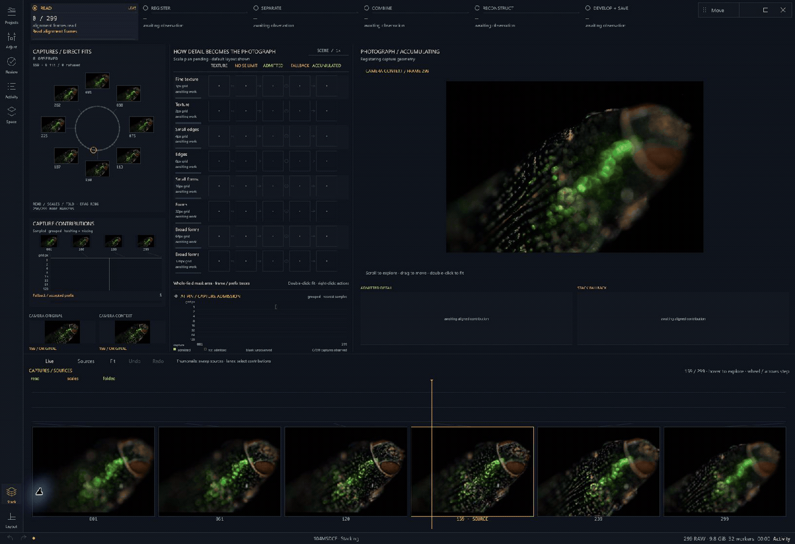
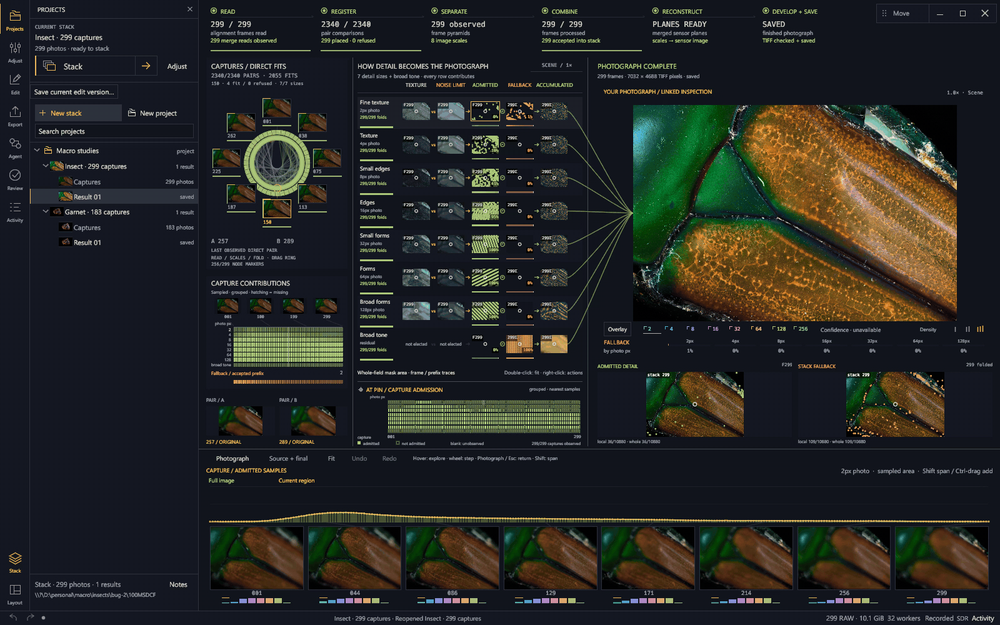

# Strehl

**RAW focus stacking you can see into.**

Strehl turns a focus bracket into a 16-bit photograph and makes the work visible:
the alignment network, detail at different scales, noise thresholds, admitted
detail, fallback averages, and the image taking shape. After stacking, the same
workspace lets you explore how the captures relate to the finished photograph.

[Download the preview](https://github.com/chcaru/strehl/releases/tag/v0.1.0-alpha.5) ·
[Desktop controls](crates/strehl-ui/README.md) ·
[Build and verify](docs/development/release-workflow.md)

## Watch a photograph come together



*Recorded from the running application with a 299-frame insect bracket.
Time-compressed footage; this is a workflow demonstration, not a speed benchmark.*

## Explore the finished stack



*The final photograph stays on the left while the source changes on the right.
The timeline, scale breakdown, and estimated admission regions follow the capture.*

## What makes Strehl different?

Strehl brings a noise-aware RAW pipeline and an inspectable visual workspace
together. Its distinctive approach is the combination of these choices:

- **Work close to the sensor.** Keep the decoded Bayer mosaic as compact `u16`
  data and perform the arithmetic in `f32`. Gather aligned samples when a kernel
  needs them, rather than building a full stack of aligned RGB photographs.
  Develop the merged result into the final color image.
- **Treat fine detail and broad structure separately.** A Laplacian pyramid
  separates the photograph into spatial scales. Each scale can draw on different
  captures, then the bands reconstruct one photograph. Multi-resolution blending
  is an established technique; Strehl builds its noise-aware decisions around it.
- **Ask whether detail exceeds the noise floor.** A shared sensor-noise model
  propagates to each band. The normal pyramid merge weights evidence above that
  scale's noise floor; where every capture is refused, it can fall back to an
  average. This avoids treating the largest noisy coefficient as automatically
  the best detail.
- **Solve capture geometry together.** Direct pairwise fits form a sparse
  network across the bracket. A robust global solve estimates frame placement
  and focus-breathing geometry, rather than repeatedly composing neighboring
  transforms. Deep-stack placement remains an active research problem.
- **Accumulate without retaining every pyramid.** Streaming accumulators and a
  memory-aware execution plan keep the working set bounded. The native desktop
  includes the engine, running in an owned worker process so rendering and
  cancellation remain separate from interaction.
- **Make the evidence explorable.** The process view connects the capture
  network, band matrix, accumulating image, and timeline. The finished photograph
  is the center of inspection: source comparisons, selected ranges, linked
  regions, and observation diagnostics modify that view.

These are implemented design choices, not a claim that every component is a
new invention or that Strehl outperforms every other stacker. The
[algorithm implementation](crates/strehl-core/src/pyramid.rs) and
[research decision record](docs/research/SYNTHESIS.md) include the assumptions,
failed approaches, corrections, and remaining limitations.

## Core features

| Workflow | What you can do |
| --- | --- |
| Organize | Browse brackets visually; organize projects, folders, stacks, recipes, and saved revisions. |
| Stack | Adjust the pyramid merge, exposure, geometry, capture limits, and execution settings; save a full-resolution 16-bit TIFF. |
| Follow | Watch direct alignment fits, band separation, admitted detail, fallback, reconstruction, and final development in one workspace. |
| Scrub | Move through captures beside the final photograph, with linked zoom and pan. |
| Select | Pin multiple capture ranges. Their estimated regions keep distinct colors, with mixed stripes at intersections. |
| Investigate | Probe a region, compare detail scales, inspect recorded sample admission, and view observation balance when recorded. |
| Arrange | Resize the workspace panes, open sidebar tools, undo exploration changes, and reset views with a double-click. |
| Automate | Use the separate CLI or build against the Rust workspace. |

**Reading the overlays:** admission marks show sampled coefficients that passed
a detail gate. They are not fractional RGB ownership, an exact winning-frame
map, or a sharpness score. Region polygons estimate coherent areas between
samples. Dashed regions on camera JPEGs are approximate projections, since those
previews are not registered final-image pixels. **Observation balance** describes
the balance of aligned observations; it is not a confidence probability or an
automatic defect detector. The [desktop guide](crates/strehl-ui/README.md) explains
these distinctions.

## Download and start

Get the platform package from the
[release page](https://github.com/chcaru/strehl/releases/tag/v0.1.0-alpha.5).

| Platform | Application |
| --- | --- |
| Windows x64 | Extract the archive and open **Strehl.exe**. |
| Linux x64 | Make the downloaded **.AppImage** executable and run it. |
| macOS, Apple silicon or Intel | Extract the matching archive and open **Strehl.app**. |

The desktop bundles its engine and application dependencies. No separate engine
installation or path selection is needed. Operating-system libraries and graphics
drivers remain prerequisites; platform baselines and verification commands are
in the [release guide](docs/development/release-workflow.md). The CLI can also be built from source for automation.

Release checksums are signed with Sigstore, and release artifacts carry GitHub
build provenance. **This preview does not have Windows publisher signing or
Apple Developer ID notarization.** These are different forms of verification;
see the release guide before installing.

1. Open **Projects → New stack**, or drop a folder of Sony `.ARW` captures.
2. Choose the bracket in the visual browser. Each stack uses one directory,
   ordered by filename.
3. Open **Adjust** if you want to change the recipe, then select **Stack**.
4. Follow the process; afterward, scrub the timeline to inspect sources against
   the result. Escape or **Photograph** restores the final image.

Source files stay in place. Each render gets a new output folder, and saved
revisions preserve their recipe and recorded observations.

## Status and limitations

**Experimental preview.** Current import paths accept Sony `.ARW` brackets.
The decoder's broader camera-format support does not imply that other formats
are supported by this application. Image quality depends on the capture,
alignment, and scene; inspect the complete result and native-resolution detail.
Occlusion boundaries, deep focus sweeps, and complex motion remain difficult.

Normal stacking runs on the CPU; the GPU draws the workspace. The display uses
8-bit textures and is not an ICC soft-proofing viewer; saved TIFF output is
16-bit. Live reconstructions precede final bounds and color development. Older
saved runs may lack newer diagnostic channels.

Windows has been exercised interactively with real photographs. The release
pipeline builds and checks Windows, Linux, and both macOS architectures; that
does not substitute for testing every desktop compositor, display scale, GPU,
or camera. Reports and reproducible examples are welcome.

## Build from source

The checkout pins Rust **1.98.0**. Install the native linker and platform
development libraries listed in the [build guide](docs/desktop-build.md).

```sh
cargo build --locked --release -p strehl-ui --bin strehl-ui
cargo run --locked --release -p strehl-ui
```

The internal Cargo target is `strehl-ui`; the distributed application is named
**Strehl**. To rebuild a release or replace the linked RAW decoder, use its
corresponding **source and relink kit**, which includes the locked dependency
sources and build instructions.

### Command-line engine

```sh
cargo build --locked --release -p strehl-cli --bin strehl
strehl probe "path/to/capture-folder" --limit 3
strehl stack "path/to/capture-folder" --merge pyramid --srgb --out "result.tiff"
strehl stack --help
```

Run the built binary from `target/release/` (add `.exe` on Windows). `--srgb` writes a viewing TIFF with full-resolution
demosaicing by default. `--binned` halves the linear dimensions.
Without `--srgb`, the default is linear, binned, camera-native RGB and can look
dark in an ordinary viewer. Supply `--out` to write an image.

The alternate `--merge estimator` backend and experiment features are research
paths, with different assumptions and settings from the normal pyramid workflow.

## Development and research

The Rust workspace contains `strehl-core`, `strehl-raw`, `strehl-plugin`,
`strehl-cli`, and `strehl-ui`. A complete source checkout also includes the
optional path dependency `experiments/native-gpu-gather`. Private photographic
corpora are not needed to launch the application or run the normal CLI.
Some research tests and scripts do require their original local data.

Read [CONTRIBUTING.md](CONTRIBUTING.md) and [AGENTS.md](AGENTS.md) before changing
the algorithms. Historical reports preserve rejected experiments and superseded
results; their claims should be read with their corrections.

[Security reporting](SECURITY.md) ·
[Release checklist](docs/public-release.md) ·
[Historical research README](docs/archive/readme-research-2026-10-18.md)

## License

Strehl's own code is [MIT](LICENSE-MIT) or [Apache-2.0](LICENSE-APACHE), at your
option. The linked RAW decoder, `rawler`, is LGPL-2.1; see the
[decoder notice](docs/raw-decoder-notice.md) and [license](LICENSE-LGPL-2.1).

Release downloads include notices and are accompanied by their corresponding
source and relink kit. Preserve those materials when redistributing the
application; do not redistribute only a statically linked executable.
