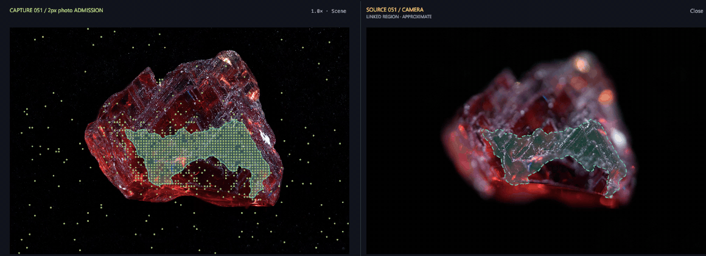
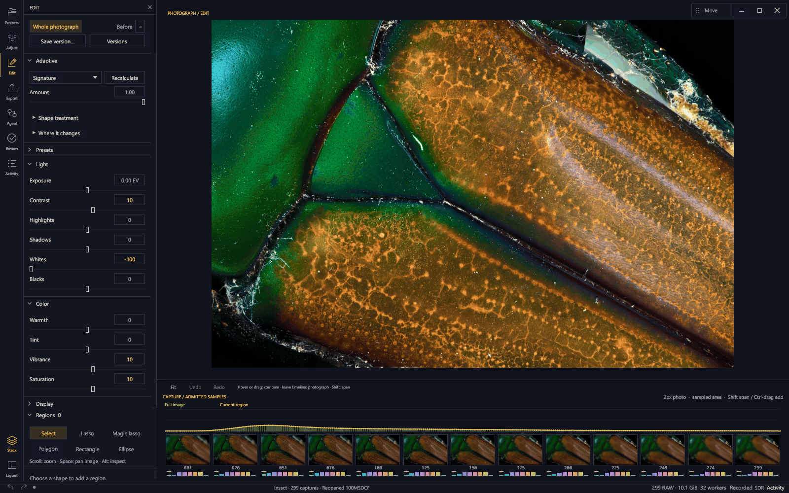

# Strehl

**RAW focus stacking you can see into.**

Strehl turns a RAW focus bracket into a full-resolution photograph—and lets you
stay inside the process. Follow the alignment network, see detail accumulate at
different scales, then scrub through the captures to explore how they relate to
the result. Develop the photograph, refine a region, and export HDR without
leaving that workspace.

[Download the preview](https://github.com/chcaru/strehl/releases/tag/v0.1.0-alpha.6) ·
[Desktop controls](crates/strehl-ui/README.md) ·
[Development and HDR](docs/development-and-hdr.md) ·
[Export formats](docs/export-formats.md) ·
[Agent interface](docs/agent-interface.md) ·
[Local desktop control](docs/desktop-control.md) ·
[Build and verify](docs/development/release-workflow.md)

## See the stack form

One continuous view connects the capture network, multi-scale detail matrix,
live reconstruction, and timeline. Alignment fits become a network of measured
relationships; the merge shows which detail passes its noise gates and where an
average supplies the fallback. The final photograph takes over when work finishes.


*A 299-frame insect bracket, from alignment through detail accumulation to the
finished photograph. Condensed to five excerpts: waits are omitted and motion
is unchanged.*

[Watch the video](docs/media/stacking.mp4) ·
[Recording details](docs/media/README.md)

## Follow the plane of focus

Move along the timeline and the source appears beside the final photograph.
Zoom and pan stay linked. Admission regions connect the image, source capture,
detail scales, and timeline; pin several capture ranges to compare their distinct
colored regions and striped intersections. Leave inspection and the photograph
returns to center stage.


*The insect stays in context while its source captures and estimated admission
regions change. Overlays describe sampled detail admission, not exact RGB ownership.*

[Watch the video](docs/media/timeline-scrubbing.mp4)

## Trace detail through a region

Inspect a crop across the photograph, source captures, and detail scales. Pin
capture spans to keep their regions in view while inspecting another part of the
stack. Fine texture and broad structure can come from different sets of captures;
the linked views keep those relationships beside the image.



*An etched garnet from 183 captures. This close view follows admitted detail and
linked zoom; the video shows the full workspace.*

[Watch the video](docs/media/mineral-exploration.mp4)

## Shape light, keep the stack

Edit the whole photograph or draw a region with an ellipse, rectangle, polygon,
or freehand lasso. Move its boundary, refine its points, feather the edge, and
adjust light and color immediately. These edits use the retained photograph;
they do not require stacking again.



*Regional light and color, spatial Adaptive, and Undo/Redo on the same photograph.
Region geometry and adjustments share the undo history; double-click a control
to reset it.*

[Watch the video](docs/media/editing.mp4)

**Spatial Adaptive** analyzes the photograph or selected region to build local
tone and color curves. Start with Signature for a stronger look, or choose
Natural, Deep background, Texture contrast, or Gentle highlights. Blend the
treatment with Amount. **Where it changes** reveals the developed difference.
These are Strehl's deterministic treatments;
the learned AI Adaptive profile is not enabled in alpha.6.

Save a treatment as a preset to recalculate it on another photograph. Save an
edit version to keep this photograph's exact recipe. Projects keeps captures,
stack results, named edit versions, and exports together, with thumbnails,
inline rename, virtual folders, drag-and-drop organization, and Reveal in Explorer.

## Keep the light beyond SDR

A scene-linear float master preserves available highlight headroom before the
SDR rendering. The viewer retains an overview while visible detail progressively
refines as you zoom; supported Windows and macOS displays can show HDR headroom.

The dedicated **Export** pane delivers AVIF, TIFF, PNG, or JPEG beside the stack's
TIFF, and records each export against its edit version. AVIF defaults to quality
100 and **HDR Rec.2020** when a linear master is available. TIFF and PNG provide
16-bit SDR output; sRGB, Display P3, and Rec.2020 are available color spaces.
HDR requires preserved source data: a new tag cannot restore clipped light from
an SDR TIFF. [Color and encoding details](docs/export-formats.md).

## Work with your agent

Enable the local **MCP interface** to share the open workspace with Codex,
Claude Code, Copilot CLI, or another MCP host. Circle an issue, then let the
agent inspect bounded crops, probe recorded diagnostics, suggest a treatment,
adjust the same recipe, or start a comparison stack. Annotations and changes
appear in Strehl; conversation and authentication stay with your chosen host.
[Connect an agent](docs/agent-interface.md).

The source-inspection and editing recordings above are driven through this same
interface, with the changes rendered in the native workspace.

## What makes Strehl different?

Strehl brings a noise-aware RAW pipeline and an inspectable visual workspace
together. Its distinctive approach is the combination of these choices:

- **Work close to the sensor.** Keep the decoded Bayer mosaic as compact `u16`
  data and perform the arithmetic in `f32`. Gather aligned samples when a kernel
  needs them, rather than building a full stack of aligned RGB photographs.
  Develop the merged result into the final color image.
- **Treat fine detail and broad structure separately.** A Laplacian pyramid
  separates the photograph into spatial scales. Each scale can draw on different
  captures, then the bands reconstruct one photograph. Multi-resolution blending
  is an established technique; Strehl builds its noise-aware decisions around it.
- **Ask whether detail exceeds the noise floor.** A shared sensor-noise model
  propagates to each band. The normal pyramid merge weights evidence above that
  scale's noise floor; where every capture is refused, it can fall back to an
  average. This avoids treating the largest noisy coefficient as automatically
  the best detail.
- **Solve capture geometry together.** Direct pairwise fits form a sparse
  network across the bracket. A robust global solve estimates frame placement
  and focus-breathing geometry, rather than repeatedly composing neighboring
  transforms. Deep-stack placement remains an active research problem.
- **Accumulate without retaining every pyramid.** Streaming accumulators and a
  memory-aware execution plan keep the working set bounded. The native desktop
  includes the engine, running in an owned worker process so rendering and
  cancellation remain separate from interaction.
- **Make the evidence explorable.** The process view connects the capture
  network, band matrix, accumulating image, and timeline. The finished photograph
  is the center of inspection: source comparisons, selected ranges, linked
  regions, and observation diagnostics modify that view.

These are implemented design choices, not a claim that every component is a
new invention or that Strehl outperforms every other stacker. The
[algorithm implementation](crates/strehl-core/src/pyramid.rs) and
[research decision record](docs/research/SYNTHESIS.md) include the assumptions,
failed approaches, corrections, and remaining limitations.

## The workflow stays together

| Workflow | What you can do |
| --- | --- |
| Find a bracket | Browse camera previews before importing. Keep projects, folders, captures, results, edits, and deliveries in one library. |
| Tune the stack | Adjust the pyramid merge, exposure, geometry, capture limits, and execution plan; render a full-resolution 16-bit TIFF and retain a linear master. |
| Read the evidence | Follow alignment and merging, then inspect admission by region and detail scale. View recorded observation balance alongside the photograph. |
| Refine a selection | Experimental **Magic lasso** traces contrasting objects or defects inside a loose enclosure. Its proposed outlines remain editable; ambiguous areas can remain unselected. |
| Repair a source choice | Limit a selected region to a capture span and **re-stack** to rebuild it. This is separate from immediate light and color edits. |
| Keep a look | Save presets, import supported numeric XMP controls, compare Before, and preserve named edit versions. Adobe AI profiles and proprietary processing are not imported. |
| Arrange the workspace | Resize panes, keep the photograph central, undo exploration changes, and double-click to reset views. |
| Automate | Use the separate CLI, portable development recipe, Rust workspace, or local MCP interface. |

**Reading the overlays:** admission marks show sampled coefficients that passed
a detail gate. They are not fractional RGB ownership, an exact winning-frame
map, or a sharpness score. Region polygons estimate coherent areas between
samples. Dashed regions on camera JPEGs are approximate projections, since those
previews are not registered final-image pixels. **Observation balance** describes
the balance of aligned observations; it is not a confidence probability or an
automatic defect detector. The [desktop guide](crates/strehl-ui/README.md) explains
these distinctions.

## Download and start

Get the platform package from the
[release page](https://github.com/chcaru/strehl/releases/tag/v0.1.0-alpha.6).

| Platform | Application |
| --- | --- |
| Windows x64 | Extract the archive and open **Strehl.exe**. |
| Linux x64 | Make the downloaded **.AppImage** executable and run it. |
| macOS, Apple silicon or Intel | Extract the matching archive and open **Strehl.app**. |

The desktop bundles its engine and application dependencies. No separate engine
installation or path selection is needed. Operating-system libraries and graphics
drivers remain prerequisites; platform baselines and verification commands are
in the [release guide](docs/development/release-workflow.md). The CLI can also be built from source for automation.

Release checksums are signed with Sigstore, and release artifacts carry GitHub
build provenance. **This preview does not have Windows publisher signing or
Apple Developer ID notarization.** These are different forms of verification;
see the release guide before installing.

1. Open **Projects → New stack**, or drop a folder of Sony `.ARW` captures.
2. Choose the bracket in the visual browser. Each stack uses one directory,
   ordered by filename.
3. Open **Adjust** if you want to change the recipe, then select **Stack**.
4. Follow the process; afterward, scrub the timeline to inspect sources against
   the result. Escape or **Photograph** restores the final image.
5. Open **Edit** for light, color, and regional adjustments; save a named version,
   then use **Export** for delivery. Source-range repairs need another stack;
   ordinary development edits do not.

Source files stay in place. Each render gets a new output folder, and saved
revisions preserve their recipe and recorded observations.

## Status and limitations

**Experimental preview.** Current import paths accept Sony `.ARW` brackets.
The decoder's broader camera-format support does not imply that other formats
are supported by this application. Image quality depends on the capture,
alignment, and scene; inspect the complete result and native-resolution detail.
Occlusion boundaries, deep focus sweeps, and complex motion remain difficult.

Normal stacking runs on the CPU; the GPU draws the workspace. Completed photographs
refine the visible area progressively, up to source-pixel resolution. Windows DX12
and macOS Metal support native HDR presentation when the active display provides
HDR/EDR headroom; Linux and other backends use SDR. The app reports the active
display mode and does not change system display settings. General ICC soft proofing
is not implemented. Saved TIFF output is 16-bit; HDR display and AVIF export require
a retained linear master. HDR export does not perform
multi-exposure bracket fusion, and an old SDR TIFF cannot recover clipped light.
Live reconstructions precede final bounds and color development. Older
saved runs may lack newer diagnostic channels.

Windows has been exercised interactively with real photographs. The release
pipeline builds and checks Windows, Linux, and both macOS architectures; that
does not substitute for testing every desktop compositor, display scale, GPU,
or camera. Reports and reproducible examples are welcome.

## Build from source

The checkout pins Rust **1.98.0**. Install the native linker and platform
development libraries listed in the [build guide](docs/desktop-build.md).

```sh
cargo build --locked --release -p strehl-ui --bin strehl-ui
cargo run --locked --release -p strehl-ui
```

The internal Cargo target is `strehl-ui`; the distributed application is named
**Strehl**. To rebuild a release or replace the linked RAW decoder, use its
corresponding **source and relink kit**, which includes the locked dependency
sources and build instructions.

### Command-line engine

```sh
cargo build --locked --release -p strehl-cli --bin strehl
strehl probe "path/to/capture-folder" --limit 3
strehl stack "path/to/capture-folder" --merge pyramid --srgb --out "result.tiff"
strehl stack --help
```

Run the built binary from `target/release/` (add `.exe` on Windows). `--srgb` writes a viewing TIFF with full-resolution
demosaicing by default. `--binned` halves the linear dimensions.
Without `--srgb`, the default is linear, binned, camera-native RGB and can look
dark in an ordinary viewer. Supply `--out` to write an image.

The alternate `--merge estimator` backend and experiment features are research
paths, with different assumptions and settings from the normal pyramid workflow.

Optional [temporal-energy guidance](docs/temporal-energy.md) remains Off by default
and can erase weak detail visible in only one capture.

Inspect A7C II focus metadata without decoding image pixels:

```powershell
strehl focus inspect "path/to/bracket" --out "focus.json" --html "focus.html"
```

The offline viewer shows the sparse AF records and bracket progression. See
[Sony focus metadata](docs/sony-focus-metadata.md) for supported layouts and limits.

## Development and research

Use the [research guide](docs/research/README.md) for topic indexes and searchable
reports, experiment results, reviews, and plans.

The Rust workspace contains `strehl-core`, `strehl-raw`, `strehl-plugin`, `strehl-edit`,
`strehl-cli`, and `strehl-ui`. A complete source checkout also includes the
optional path dependency `experiments/native-gpu-gather`. Private photographic
corpora are not needed to launch the application or run the normal CLI.
Some research tests and scripts do require their original local data.

Read [CONTRIBUTING.md](CONTRIBUTING.md) and [AGENTS.md](AGENTS.md) before changing
the algorithms. Historical reports preserve rejected experiments and superseded
results; their claims should be read with their corrections.

[Security reporting](SECURITY.md) ·
[Release checklist](docs/public-release.md) ·
[Historical research README](docs/archive/readme-research-2026-10-18.md)

## License

Strehl's own code is [MIT](LICENSE-MIT) or [Apache-2.0](LICENSE-APACHE), at your
option. The linked RAW decoder, `rawler`, is LGPL-2.1; see the
[decoder notice](docs/raw-decoder-notice.md) and [license](LICENSE-LGPL-2.1).

Release downloads include notices and are accompanied by their corresponding
source and relink kit. Preserve those materials when redistributing the
application; do not redistribute only a statically linked executable.
