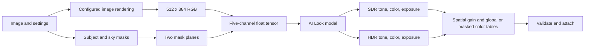

# REA and Adobe Adaptive: local investigation

Reviewed 2026-10-21. **VERIFIED (static)** means inspected installation data,
decompiled control/data flow, or checked machine instructions. It does not mean
that Adobe's model ran, its appearance was reproduced, or a Strehl student was
trained. **DERIVED** identifies arithmetic or interpretation from that evidence;
**UNVERIFIED** identifies remaining gaps.

## Scope and reproducibility

The native pass used [REA](https://github.com/morluto/rea),
`rea-agents@6.7.0` (MIT), with Ghidra 12.1.4 and Temurin Java 21.0.12.1.
Tools and reconstructed pseudocode remain in ignored local research storage.
No Adobe binary, profile, model payload, or reconstructed implementation is
part of Strehl's source or release. The native pass used static analysis only,
with no desktop automation or target/model execution.

The installed Lightroom CC executable is native x64, version 9.3.1. The
Adaptive implementation traced here is in its adjacent **CameraRaw.dll**:

| Identity | Value |
| --- | --- |
| File size | 150,472,688 bytes |
| SHA-256 | `06ce47a47d7ee0ef9debc77343d55e774cc11edb117dbd7b8fd9f09e3ecbbefc` |
| Preferred image base | `0x180000000` |
| Model resource | `Resources/ModelZoo/ai_look/winml/adobelook.data` |
| Model payload size | 5,895,920 bytes |
| Model payload SHA-256 | `76d9d98782d099111a315aba5883f6338b3fef110ba4c68b9a04fef99df424ad` |

Addresses below are preferred virtual addresses in that exact DLL, not stable
APIs or live addresses. RVA is the listed address minus the image base. ASLR
and application updates must be accounted for before reuse.

REA's `open_binary`, `procedure_pseudo_code`, `procedure_assembly`, `xrefs`,
and `read_bytes` were run through its MCP server. A single Ghidra import was
reused for the queries. It recovered C-like pseudocode, not original source.
Critical floating-point arguments were checked against assembly and constants:
the initial decompiler output misrepresented the mask conversion scale.

## Recovered path

**VERIFIED (static):** the high-level flow is cache lookup, image/mask
preparation, inference, gain/color table construction, then serialization
validation and attachment to the image.

This is a map of recovered data flow, not an independently executable renderer.
It omits the optional second invocation described below.

| Role | Address |
| --- | --- |
| `CalculateAILook` orchestration | `0x181369770` |
| Tapout settings preparation | `0x18136c880` |
| Image preparation and bilinear resizing | `0x18136d450` |
| `RenderPostToneMapImage` | `0x1819a6600` |
| Image/mask bridge into inference | `0x181a59910` |
| `ai_look::DoInference` | `0x181d35bd0` |
| AI Look model manager lookup | `0x181d828b0` |
| Model dispatch | `0x181d82140` |
| Model-manager evaluation | `0x181d93b80` |
| Input tensor binding | `0x181d97740` |
| Sensei SDK prediction wrapper | `0x181dcd560` |
| WinML model factory | `0x181dbfe30` |
| WinML model loading | `0x181dd64c0` |
| WinML prediction | `0x181dd7ed0` |
| Output tensor binding | `0x181d9fc80` |
| Spatial gain table construction | `0x18136d790` |
| Global/masked color table construction | `0x18136de10` |

The model manager identifies `ai_look`; its platform configuration selects
`winml/manifest.json`. The native factory constructs `AdobeSensei::SenseiWinML`;
the prediction wrapper reaches its virtual SDK operation.
The resource manifest identifies the payload as `secured_file`. Following its
native loading path allowed the installed model to be decoded into a local
ONNX research artifact. No Adobe application or model inference was executed.

## Recovered model artifact

**VERIFIED (static):** `python outputs/ai-adaptive-investigation/inspect-local-model.py`
decoded the installed payload, checked its known source hash, parsed the
result with ONNX, and passed `onnx.checker.check_model(..., full_check=True)`.
An intentionally wrong decoding key was rejected. Inputs match the installed
manifest exactly; output names and element counts match, while the graph's
shapes retain dimensions that the manifest flattens.

| Model property | Observed value |
| --- | --- |
| Decoded size | 5,895,891 bytes |
| Decoded SHA-256 | `57fc815dda670fe484236cd8b8d71768d0a02d1ad26b75c76bef4cbcd8412adb` |
| Producer metadata | PyTorch 1.13.1 |
| ONNX IR / default opset | 7 / 14 |
| Graph nodes | 1,043 |
| Stored initializers / elements | 255 / 1,431,423 |
| Model inference | Not run |

Initializer elements include fixed tensors and are not a verified count of
trainable parameters. Structural validation and matching interface metadata
establish a recovered graph, not appearance, inference performance, or a
faithful standalone Lightroom renderer. The graph, weights, container decoder,
and decompiled implementation stay in ignored local research files.

An independent static review ran
`python outputs/ai-adaptive-investigation/inspect-graph-structure.py`. It cleared
declared output shapes and intermediate shape hints, re-derived the output
dimensions from topology, and rejected deliberately incorrect input/output
channel counts. It found a four-stage attention encoder with widths
16/32/80/128, and separate tone, color, and exposure heads. Color lattices grow
from 2-cubed to 32-cubed through 3D convolutions, then combine with a baseline,
pass through a sigmoid, and receive spatial smoothing within the color lattice.
This is a structural description, not a photographic quality result.

The first graph operation consumes all five channels directly in a learned
convolution. No explicit input normalization precedes it inside the graph;
normalization in the native binder remains a separate unresolved question.
Color baseline tensors contain negative infinities before a sigmoid, so
structural validation must not be described as a finite-output check.

## Input contract

**VERIFIED (static):** the five input channels are RGB, subject/portrait mask,
and sky mask. The image bridge uses 32-bit float RGB; masks begin as bytes.
They are resized to 512 x 384, split/assembled in that order, and bound as
contiguous NCHW float32 with shape `[1, 5, 384, 512]`.
The AI Look configuration selects this planar binder; the alternative generic
binding branch is not being assumed to have the same layout.

**DERIVED:** byte offset is `4 * ((channel * 384 + y) * 512 + x)`, row stride
2,048 bytes, channel stride 786,432 bytes, total 3,932,160 bytes. This layout
is supported by the binder's plane offsets and external-data Mat constructor,
not merely guessed from the manifest.

**VERIFIED (static):** mask conversion uses zero offset and the double
`0.003921568859368563`, a float-rounded reciprocal of 255 widened to double.
The call at `0x181d36596` receives that scale in XMM3; its constant is at
`0x184ae9518`. The image-to-Mat copy preserves channel order without an
explicit scale or gamma operation.

The primary image passes through `RenderPostToneMapImage`, with a tapout
configuration that selects Adobe Standard when available. It is therefore a
configured image rendering, not untouched CFA data. **UNVERIFIED:** its exact
primaries, transfer function, numeric range, clipping policy, and active
values of the generic binder's optional per-channel normalization. A profile
name or familiar luminance weights cannot resolve those questions.

**VERIFIED (static):** a conditional branch computes `MakeLogRadImage` at
`0x18136d090`, using exposure time, ISO, aperture, and a logarithmic transform.
However, the returned image and the image passed to the next inference have
different local storage addresses in both pseudocode and caller assembly.
**UNVERIFIED:** whether shared storage or another mechanism connects them.
Do not claim that this calculation proves the network receives log radiance
or uses capture metadata.

## What the outputs represent

**VERIFIED (static):** ten named outputs are consumed:

| Family | Names | Interpretation established by consumers |
| --- | --- | --- |
| SDR tone | `pgtm` | 96 x 128 spatial locations, each with 16 scalar gain knots |
| SDR color | `rgbt_0`, `rgbt_1`, `rgbt_2` | Three 32-cubed input-color lattices, each with RGB output |
| SDR exposure | `exposure` | One float |
| HDR tone | `pgtm_hdr` | Same tone-table dimensions |
| HDR color | `rgbt_0_hdr`, `rgbt_1_hdr`, `rgbt_2_hdr` | Same color-table dimensions, with HDR-specific postprocessing |
| HDR exposure | `exposure_hdr` | One float |

The decoded graph independently confirms the output layouts: tone tensors
are `[1,16,96,128]`, color tensors `[1,3,32,32,32]`, and exposures `[1,1]`.
The manifest's corresponding flattened shapes are `[1,1,196608,1]`,
`[1,1,98304,1]`, and `[1,1,1,1]`. Treating these as identical shapes initially
failed an assertion; the actual dimensions agree with the native consumers.

Tone dimensions are before orientation; rotation can swap the spatial axes.
The 16-entry axis describes brightness-dependent gain, not colors, focus
bands, or stack depth. Tables interpolate across the full photograph; their
small spatial size does not limit the final image's resolution.

The gain-table constructor rearranges planar predictions into interleaved
knots and preserves crop origin, spacing, and orientation. It passes five
lookup weights approximately `[0.2126, 0.7152, 0.0722, 0, 0]`, gamma about
`1/2.2`, and unsigned-16-bit table serialization. Runtime working buffers are
float32. Observed range metadata is bounded to `2^-12 ... 2^12`; this is not
proof that all predicted samples are clamped to that range.

**DERIVED using the public DNG definition:** those weights and gamma choose
the brightness coordinate within each local gain curve. They are not an RGB
conversion matrix or evidence that the model's input is sRGB. See
[DNG 1.7.1, ProfileGainTableMap/Map2](https://helpx.adobe.com/content/dam/help/en/camera-raw/digital-negative/jcr_content/root/content/flex/items/position/position-par/download_section_733958301/download-1/DNG_Spec_1_7_1_0.pdf).

The color tables operate over color coordinates, not image positions. The
caller installs global color and separate subject/sky masked color tables.
The HDR constructor performs additional decode, luminance/lattice processing,
ratio adjustment, and re-encoding. **UNVERIFIED:** its exact transfer and
repair semantics. Raw HDR output floats must not simply be treated as a
linear-RGB LUT.

**VERIFIED (static):** the orchestration probes a cache before inference. It
can invoke the model twice when image identities differ; that test is not
simply an HDR-enable flag. The first output family is retained while the
second invocation replaces the second family. Constructed tables are
serialized and read back before attachment; failure raises an error.
**UNVERIFIED:** the complete cache key and every setting that invalidates it.

## Implications for a Strehl AI option

Adobe's [public description](https://blog.adobe.com/en/publish/2024/10/14/the-adobe-adaptive-profile)
describes the same broad combination of spatial tone, global/subject/sky
color, and separate SDR/HDR treatments. Native inspection now establishes
specific input packing and table construction beyond that description.

**ARGUED:** a compact predictor of spatial gain curves plus global/masked
color tables is a useful candidate for Strehl. Full-resolution application
could remain separate from low-resolution inference, fitting the progressive
preview requirement. This is a design candidate, not measured performance or
an implemented learned profile.

The recovered graph provides a concrete starting point for a local teacher.
Distillation still requires verified inference, a defined input and output
color contract, representative examples, held-out photographs, and independent
full-image review. These have not been established by this static pass. The
5.9 MB payload size alone says nothing about inference latency or whether a
smaller student would preserve appearance. Existing Strehl Adaptive treatments
remain original heuristics; no option is relabeled as learned AI.

A scene-referred LinearRaw DNG bridge remains a possible standards-based
experiment. Adobe acceptance, generated table export, and color fidelity
have not been demonstrated. The installed Adaptive profile declares
scene-referred support and no output-referred support; a rendered TIFF is
not interchangeable with its expected input. Adobe's
[DNG Converter CLI](https://helpx.adobe.com/content/dam/help/en/camera-raw/digital-negative/jcr_content/root/content/flex/items/position/position-par/download_section/download-1/dng_converter_commandline.pdf)
does not document an Adaptive rendering command.

## Local evidence and earlier pass

The local `outputs/ai-adaptive-investigation` directory contains the native
target inventory, request/response receipts, extracted pseudocode/assembly,
and a navigable code-path report. These are deliberately excluded from Git.
The public document records findings and limits, not Adobe implementation.

The earlier metadata-only pass under `outputs/rea-review` ran REA
`inspect-pe-resources` and `inspect-managed-artifact`: Lightroom was native,
with no CLR directory. At that time no native provider was configured; the
later portable Ghidra setup resolved that limitation. The installed 6.7.0
package returned `COMMAND_NOT_FOUND` for the documentation's
`inspect-desktop-application` and `inspect-model-artifact` commands. The
successful native pass used the provider tools listed above instead.
