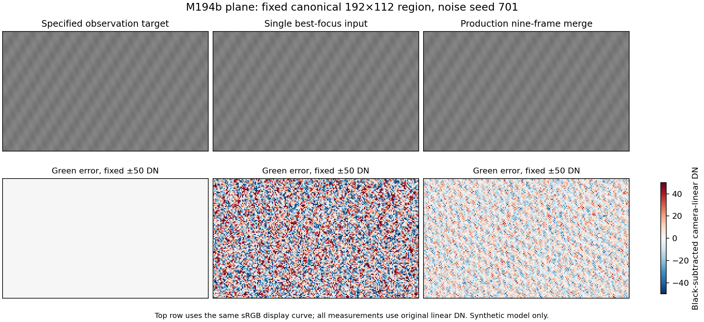

# M194b — a known-scene baseline through the production merge

2026-09-07. **MEASURED and independently verified within a fixed synthetic
scope.** Forty actual production TIFFs now have known input scenes, independent
reference calculations, explicit geometry and temporal-noise measurements.
The benchmark also exposed a real limitation: changing decoded-buffer padding
changes the measured noise-floor probe and therefore delivered pixels. That
failed control is retained; this is not an all-controls-green or SOTA result.

## Decision

Use this benchmark to develop and reject changes on the actual production
path. Preserve its two target conventions: the stack is quieter and closer to
the specified in-focus optical observation, yet farther from the ideal latent
scene on the textured-plane fixture. Analytic color also loses accuracy in the
full stack. Those are separate observations, not one overall quality score.

The next bounded product work is **M194c**, repairing the demonstrated
dependence on unused decoded storage. Reuse these inputs unchanged to report
the resulting pixel/error/noise movement. Subsequent color/gather or admission
work must retain the flat and wave controls; do not pick whichever target
favors a proposed change. Two-layer occlusion and physical-reference work remain
separate, unfinished parts of the program.

## Registration and prior art

M194's shared decoded-frame source and production-byte checks were committed at
`19e230fbd44f58badd0959906ae1f1eb5519c60a`. M194b was allocated before dispatch.
The fixed benchmark, producer, consumer, scorer and independent briefs were
committed at `f1286fdaa8347bcbc60d78e171bd6eef25eb0ba6` before production
measurement. They are in
[`experiments/m194b-known-scene/`](../../experiments/m194b-known-scene/), led by
[`preregister.md`](../../experiments/m194b-known-scene/preregister.md).

The mechanical prior-art query and every returned report are recorded there.
The design reuses M25's scalar layers and the analytic component approach of
BUILD-DEMOSAIC. It preserves M25's failed physical optics/occlusion claims,
BUILD-BLEND's scene refusal, the M103 per-frame/gauge correction, calibration
retractions and real-reference limits. No M25 source, historical certificate,
scorecard, RAW capture or sealed holdout changed.

Author roles: directional_detail producer, implementation_audit consumer,
root scorer/controller. roadmap_audit independently re-chose the optical,
sensor, coordinate and scoring controls and read every baseline TIFF.
directional_detail separately reviewed the root-owned controller/reader;
that review does not verify its own producer's scientific claims.

## Exactly what ran

Inputs are 20 manifests and 180 active-CFA files, each nine-frame stack at
320x240 native pixels. Storage is u16; production arithmetic and the injected
model retain their existing f32 path. Scalar scenes have a noise-off instance
and eight independent repeats, seeds 701,709,719,727,733,739,743,751. Analytic
color and its achromatic null are noise-off component fixtures.

| Fixture | Full-nine outputs | Original best-frame outputs |
|---|---:|---:|
| Flat, noise-off plus eight repeats | 9 | 9 |
| Textured scalar plane, same repeats | 9 | 9 |
| Analytic spatial color, noise-off | 1 | 1 |
| Analytic achromatic null, noise-off | 1 | 1 |

The sensor coefficients are deliberately synthetic: gain 0.25 DN/electron,
read noise 4 electrons, black 512, white 15360, ISO label 160. No FPN, PRNU,
hot-pixel or correlated-noise component is enabled. The same explicit model is
injected once through `PreparedPyramid`; no camera-profile lookup replaces it.
These controls validate an operation, not physical camera calibration.

The scalar plane has two known oriented waves, constant focus 4, circular
diffraction at effective f/16 and 535 nm, and a uniform-disc defocus diameter
of 1.5 native pixels per focus-index separation. S4 midpoint sampling and a
48-pixel margin were fixed before controls. Scalar channel factors are
(0.75,1,0.60), with fixed WB (4/3,1,5/3). Color is a separate analytically
cell-integrated RGB fixture; it does not silently extend M25's scalar API.
Exact functions and conventions are in the committed producer preregistration.

Nine nonlinear scale values come from the already published M103 ladder,
referenced to frame 4, about native centre (183,101). This is reuse of derived
numbers as a software stimulus, not a new independent capture measurement.
No alignment estimator is run. Every frame consumes its own known forward map.

The production baseline is Pyramid, gate 2, Catmull-Rom, three Laplacian bands
plus base, two workers, full-resolution MHC and CameraLinear output. Other
resolved settings are pinned in every plan, including SoftPower, exponent 2,
`sharpen_per_octave` 1.4, mean base, InputRange hull and the measured gate floor.
There is no automatic exposure, CA correction, defect correction or restoration.
This small-image configuration is not the default-seven-band quality/performance
certificate.

All 20 actual Crop plans were saved **before the first baseline TIFF**.
The crop is quad `(9,7,142,106)`, producing 284x212 RGB16. Output `(u,v)` maps
to canonical native `(u+18,v+14)`. Every score uses the same canonical
rectangle x in [64,256), y in [64,176): **21,504 pixels**. Single-frame outputs
retain the nine-frame crop, centre and original frame-4 geometry. They reindex
that frame to source-local 0, which also changes the existing probe seed to
local 0; they are actual single-input algorithm comparators, not an isolated
test in which every intermediate probe sample is shared with the full stack.

The frozen executable in `consumer-build-3.json` is SHA-256
`92d2a31b03152c88060d7c2355b6071acf73e74450ca1cd3606f85f6ee814dc5`.
The complete 60-command render index is
[`baseline-1/run-index.json`](../../experiments/m194b-known-scene/baseline-1/run-index.json),
SHA-256 `37f99736bd32dfb4891bd8fa2b033cacc2c58e9265515fa53cb5921dd80d9c08`.
It binds the build, source snapshots, inputs, plans, command evidence and all
40 actual TIFFs. Generated CFA/NPY/TIFF payloads remain locally available in
ignored paths; their manifests and content hashes are retained with the source.

## Controls and their limits

The producer's seven groups and 93 author checks pass. Independent controls
change the aspect ratio, phases, numerical integration and noise draws.
The detailed records are the
[producer fragment](../../experiments/m194b-known-scene/producer-report-fragment.md),
[consumer notes](../../experiments/m194b-known-scene/consumer-notes.md) and
[independent review](../../experiments/m194b-known-scene/independent-review.md).

| Property | Evidence and rejecting controls |
|---|---|
| Numerical optics | Independent real-space disc and pupil-overlap integrals; deletion of diffraction, wrong radius, wavelength/effective aperture and lost negative OTF lobes reject. This commissions the declared numerical model, not a camera PSF. |
| Sampling and margin | Primary S4-to-S8 maximum per-frame ROI RMS change 0.200388 post-WB DN; margin48-to96 maximum 0.00332962 DN. Both pass the frozen 1 DN budget without refinement. The preregistered engineering rule refuses rankings below twice the relevant numerical difference; this is not a propagated error bound, and S8 is not exact truth. |
| Noise and active CFA | Independent temporal-law/covariance controls reject wrong gain, removed read noise, identical frames and matched-variance correlated noise. All 180 actual CFA files were read independently. Actual repeat variance ratios to the declared law span 0.997334–1.003208. |
| Observing expected electrons | Original/on/allocated-disabled-placebo source arrays are byte-identical; replaying cached expectations reproduces them exactly. |
| Selective failure | Injected failed optical groups withhold the plane and retain 11 valid flat/color manifests, with all 99 corresponding CFA files byte-identical. Partial refusal exits 2; it cannot masquerade as the complete baseline. |
| Consumer | Explicit decoded storage, source hashes, geometry, noise/configuration and pre-render plans reach the existing production body. Refusal controls and confidence non-perturbation pass. The separate padding identity fails, described below. |
| Scoring | Independently phased actual TIFFs, direct moments/Welford variance, spatial Gaussian blur, phase/color/offset errors, flat noise and paired-repeat checks. A blur may improve noisy MSE; fixed-wave and noise-off readouts expose this failure direction. |
| Actual output/package | Independent reading of all 40 TIFFs agrees with author RMSE within 2.77e-7 DN, wave amplitudes within 4.50e-12 DN and temporal variance within 1.01e-11 DN². Ten coherent geometry/config/readout corruptions and twelve separate command/source/order corruptions reject, with valid controls admitted. |

Metadata-only rotation, ICC and contradictory color-description mutations
reject even when numeric pixel arrays are unchanged. The strict reader binds
the complete configuration, expected crop, parent/child commands, source
snapshots, compiler artifact and actual output bytes. Its external trusted
index/build digests are still a provenance boundary; it does not authenticate
entirely fabricated replacement evidence.

## Baseline results

**MEASURED, black-subtracted, post-WB camera-linear DN.** Full RGB/channel/region rows,
per-repeat values, paired uncertainties, wave phases, masks and hashes are in
[`baseline-score-v3.json`](../../experiments/m194b-known-scene/baseline-score-v3.json).
The following compact table shows green only; it is not a pooled RGB score.
All normal source and output rail counts are zero.

| Green quantity | Single original frame 4 | Full nine frames |
|---|---:|---:|
| Flat temporal sigma, eight repeats | 25.472 DN | 13.538 DN |
| Plane temporal sigma, eight repeats | 25.365 DN | 9.755 DN |
| Noisy plane RMSE vs optical observation | 29.178 DN | 14.182 DN |
| Noisy plane RMSE vs ideal latent scene | 63.610 DN | 69.916 DN |
| Noise-off plane RMSE vs optical observation | 14.407 DN | 10.360 DN |
| Noise-off plane RMSE vs ideal latent scene | 58.267 DN | 70.020 DN |
| Noise-off analytic color RMSE vs known color | 34.143 DN | 38.347 DN |
| Noise-off achromatic component RMSE | 19.371 DN | 29.472 DN |

Uncertainty uses independent **whole-image repeats**, not assumed-independent
pixels. For the plane, paired full-minus-single green MSE is
−650.206 ± 2.642 DN² SEM against the optical observation, but
+842.028 ± 8.435 DN² against the ideal target. Its temporal-variance difference
is −548.204 DN², with delete-one-repeat jackknife SE 2.892 DN². For the flat,
the temporal-variance difference is −465.511 DN² with jackknife SE 2.753 DN².
The raw paired and leave-one-out values are retained. Eight repeats give a
development diagnostic, not a precision noise certificate.

The two noise-off plane waves have lower amplitude in the full stack:
approximately 374.8 and 150.2 DN versus 384.6 and 164.6 DN in the single output.
Thus the noise reduction accompanies attenuation. The full stack is nearer the
specified optical observation and farther from the hypothetical sharp object;
neither statement can replace the other. `T_ideal` removes the declared optical
blur; its exact attainability is not established by this benchmark.
`Y_single` is realizable, but is not a universal
lower bound on reconstruction error. No free gain, offset, registration or
output-driven crop was fitted to improve either comparison.

The scalar targets account for the actual f32 WB factors. Analytic color keeps
its desired exact target and discloses the very small finite-arithmetic
discrepancy from the producer's f64 inverse WB followed by f32 output WB.
The mean-MSE/variance decomposition is explicitly labelled an arithmetic
identity; it is not independent evidence for the model.



The figure uses a common display curve and a fixed ±50 DN green-error scale.
It was inspected at original export resolution for layout. Numerical conclusions
come from the original TIFF samples and fixed masks, not display interpolation.

## A failed invariant and its causal control

**MEASURED defect on the declared consumer path.** The verifier moved identical
active CFA data from origin (2,4), stride 327, storage height 247 to valid origin
(7,3), stride 339, height 251. Geometry, levels, WB and input pixels were held
fixed. With the measured floor, **149,804 of 180,624 output components differ**,
by at most **8 TIFF LSB**. Exact repeats and confidence on/off remain byte-identical.
The original consumer test therefore reports 51 of 52 expected controls, not 52.

`Probe::run` fills its deterministic synthetic noise over the entire decoded
storage buffer. A different stride/origin assigns different probe noise to the
same active photosites. Source inspection and different floor summaries alone
would be correlational. The independent intervention supplies the missing
causal test: with the existing white-floor setting, original and alternate
storage produce **byte-identical whole TIFFs**; the white setting also changes
the original output, and the measured-floor pair reproduces its original bytes.
All nine intervention/refusal controls pass. The diagnostic has an explicit
plan label and cannot reuse a normal baseline plan.

This identifies the measured-floor path as the mediator for this fixture.
It does not establish invariance for every other render or invalidate the
fixed-layout baseline's target/noise observations. M194b deliberately leaves
the production defect unchanged for the next measured repair.

## Reproduction, retained failures and rule checks

The exact producer commands are in its fragment. The baseline index records
the `run-baseline.py` invocation and all 60 child operations, with every
argument, relevant environment value and log. The final analysis command is:

```text
python -X utf8 experiments/m194b-known-scene/score-benchmark.py --index experiments/m194b-known-scene/baseline-1/run-index.json --expected-index-sha 37f99736bd32dfb4891bd8fa2b033cacc2c58e9265515fa53cb5921dd80d9c08 --reader-binding experiments/m194b-known-scene/reader-revision-v3.json --reader-binding-sha f8740c75c5d65842d8b1993807ad99b27e988c7fb659e6f52fcd3848a6f65f00 --out experiments/m194b-known-scene/baseline-score-v3.json
```

Output paths are create-new; use a fresh result path when reproducing. The
independent review records its separate commands and alternative choices.
The renderer/control scripts preserve original module hashes. Python 3.12.10,
NumPy 2.4.4 and SciPy 1.17.1 are recorded for the producer.

The first reader refused equivalent Windows compiler paths, and its first
revision then refused ordinary versus extended-length names for the same TIFF.
Both failed attempts produced no score. They are retained in
[`reader-failures.json`](../../experiments/m194b-known-scene/reader-failures.json).
An explicit, hashed post-render reader revision preserves the original render
index/source snapshots while naming the repaired analysis code. V2's 9-of-10
coherent-corruption result is also retained; v3 adds the frozen plan field set.
No pixels, masks, settings, formulas or tolerances were changed by these repairs.

Other author/verifier mistakes are disclosed in their notes: a syntax-only
producer parenthesis error, initial consumer compile errors, an initially
mislabeled build timestamp, scalar f32 reference promotion,
a command-log filename collision, unlabelled component TIFFs and a wrongly
assumed unchanged crop under a changed transform. None is relabeled a product
defect or silently counted as a passing gate.

Product changes here are test-only: an ignored known-scene module and dev-only
serde/serde_json/sha2 dependencies with permissive metadata/licenses recorded.
The lockfile adds 98 lines and removes none. The production numerical body is
unchanged. Visible compilation precedes 128 passing CLI unit tests with this
one fixture-driven test ignored; explicit fixture invocations run separately.
Scoped formatting and Clippy pass with rebuild evidence; existing repository
strict-lint/formatting debt is not claimed fixed.

Applicable AGENTS checks: u16/active-area/injected-model/source-at-consumption
rules are exercised by actual CFA/consumer paths; flat-first, falsifier,
independent-choice and placebo rules by the registered controls; temporal vs
spatial quantities and metric failure directions are explicit above. Geometry
numbers name the frame-4/native or quad gauge. Every command and source binding
is retained, diagnostics have actual hash controls, and failed outcomes remain.
No performance sweep, whole-corpus mutation claim, external source import,
SYNTHESIS numbering/fold, new physical capture or SOTA admission is made.
