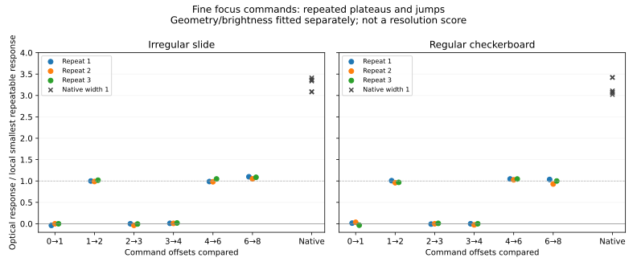

# First physical Sony focus-control results

Date: 2026-11-07. Owner: root. Scope: author-run review of two completed a7C II
tests; no independent research review, production change or SYNTHESIS fold.

**MEASURED, locally:** both subjects show repeatable optical changes smaller than
native focus-bracket width 1. A pairwise blur-response diagnostic estimates the
smallest repeated change at about **one-third** of the native step near the two
tested focus positions. This is evidence for finer focus acquisition, not a
threefold resolution improvement or a micrometre calibration.

**MEASURED:** individual command integers do not consistently produce distinct
focus planes. Across all three repeated sweeps of each subject, offsets 0→1,
2→3 and 3→4 form plateaus; 1→2, 4→6 and 6→8 produce clear, similarly sized optical
changes. Exact software readback must not be presented as physical encoder
resolution. The underlying lens/controller quantization mechanism is unverified.

The owner confirms the targets were absolutely stationary. All observations
below concern recorded image geometry and blur; none establishes subject motion.
Focus breathing is a plausible contributor to geometry changes. Its presence
does not by itself identify the origin of residual slow changes at a fixed
command value.

## VERIFIED: complete acquisition and RAW reconciliation

Input root: `D:/remote-control-test`, kept read-only. Inventory: 158 files,
5,343,085,974 bytes, including 146 distinct ARWs. SHA-256 identities and the
complete log-to-image mapping are in
[`capture-summary.json`](evidence/capture-summary.json). Full private metadata
remains in the local `outputs/sony-focus-control-capture-review/inventory.json`.

| Quantity | Irregular slide | Regular checkerboard |
| --- | --- | --- |
| Session suffix | `141709-2df448f6` | `142917-26f4c92d` |
| Original RAW count | 73 | 73 |
| ISO / reported aperture | 100 / f/5.6 | 100 / f/5.6 |
| Shutter | 1 second | 1/5 second |
| WB temperature / RGGB | 3000 K / 1637,1024,1024,2774 | 3300 K / 1775,1024,1024,2498 |
| Baseline command | 60627 | 61693 |
| First 55 singles, `100MSDCF` | `DSC00060`–`DSC00114` | `DSC00115`–`DSC00169` |
| Native nine-frame groups | `101MSDCF`, `102MSDCF` | `103MSDCF`, `104MSDCF` |
| Run elapsed time, including setup/restoration | 293.65 s | 235.15 s |
| Explicit focus commands / exact readbacks / completion callbacks | 64 / 64 / 64 | 64 / 64 / 64 |
| Logged restoration failures | 0 | 0 |

Each run has 57 shutter commands producing all 73 expected RAWs. The two native
commands each produced nine images in their own folder. Every capture reports
memory-card storage, no host files, and the SD destination before and after.
Both runs report successful settings restoration; this verifies logged command
completion, not identical optical focus after restoration. IBIS is recorded off.
There are no missing or byte-identical RAW files. Exposure, ISO, aperture and
WB are constant within each run; the subjects are never compared as exposure
or image-quality alternatives.

The camera clock is roughly 66 minutes ahead of the laptop. The mapping uses a
constant offset within each run, relative timing, sequence counts, exposure
metadata and the native folder boundaries. It does not assume clock agreement.
The source names and hashes, rather than time alone, identify every image.

**VERIFIED:** RawPy decoded all 146 files. The first frame of each run was also
decoded through the existing Strehl RAW wrapper. All **32,947,264 samples** in
the common 7028×4688 active rectangle agree exactly in each check. Strehl reports
7032×4688; the extra four columns are excluded from every comparison and metric.
No decoded sample reaches the Sony metadata white level of 15360. The observed
maximum is 2482 DN in run 1 and 2393 DN in run 2, with nominal black 512 DN.
LibRaw's generic white value is 16383; that value is not used as the clipping
threshold. See [`decode-summary.json`](evidence/decode-summary.json).

## MEASURED: optical response beyond command acknowledgements

The quantitative inputs are original, undemosaiced G1 samples stored as u16.
Analysis arithmetic is f32. G1 coordinate `(u,v)` corresponds to active sensor
`(1+2u,2v)`; no WB, sharpening or camera JPEG is used for these measurements.

First, a diagnostic finds the sharp band on each tilted target from the ratio
of noise-corrected gradient energies at two spatial scales. Each image is fit
independently in three horizontal sectors. This confirms the direction and
repeated plateau pattern, but the irregular slide's uneven texture makes its
absolute fitted band position unreliable as a precision ruler. The band fit
also combines optical focus and image placement. Its displacement is not
converted into focus distance, motor motion or resolution.

The headline comparison therefore uses a second diagnostic on adjacent pairs.
It fits six affine image-motion terms, brightness gain/offset, uniform blur and
a blur term varying across the tilted focus band. Sampling is every fourth G1
pixel in the central 76% of image width and within ±300 G1 pixels of the initial
band; Gaussian smoothing is 2 G1 pixels. The coefficient of the varying blur
term is an empirical optical-response coordinate. All parameters are fixed
within each subject. Fit condition numbers remain below 4.11. This separates
first-order breathing/placement effects from blur; it is not a complete physical
model of nonlinear lens breathing or aberrations.

| Pairwise response statistic, arbitrary units local to the subject | Slide | Checkerboard |
| --- | --- | --- |
| Plateau medians, three sweeps | +0.00171, +0.00067, +0.00357 | −0.01335, −0.01453, −0.01022 |
| Moving-step medians, three sweeps | −0.07505, −0.07513, −0.07686 | −0.12535, −0.11827, −0.11836 |
| Moving minus plateau magnitude | 0.07676, 0.07580, 0.08044 | 0.11200, 0.10374, 0.10814 |
| Native response / local increment | 3.35 | 3.09 |

The final row compares the median magnitude of the first three adjacent native
steps in each of two bursts with the median plateau-corrected custom increment.
Native bracketing runs toward decreasing commands; the custom sweeps increase
commands. The native and custom comparisons also occur at different times and
slightly different focal planes. Consequently **approximately three times finer
local response** is justified as a feasibility estimate; a precise physical
step ratio is not. The ratios are computed independently within each subject.
The full coefficients are in
[`pair-response.json`](evidence/pair-response.json)
and [`review.json`](evidence/review.json).



Both native nine-frame bursts end 70 command units below their starting value.
Dividing by eight intervals gives 8.75 command units per interval on average;
this endpoint arithmetic does not establish equal interior steps or a physical
unit conversion. Likewise, neither the observed plateaus nor the optical ratio
justifies installing a global "three command units = one motor step" rule.

## MEASURED: approach dependence and slow image changes

Returning to the same command value from opposite directions produces a
repeatable blur-response difference: 0.0756–0.0875 on the slide and
0.0830–0.1025 on the checkerboard. These are roughly one of the small increments
above. This is consistent with approach-dependent optical positioning; the
test does not distinguish mechanical backlash, lens control behavior or other
causes. A consistent approach direction is warranted for subsequent acquisition.

The checkerboard's five initial no-command images show a changing fitted sharp
band, spanning about 2.1 sensor pixels. There is also a slower change across
repeated visits to the same command value. The pairwise model fits geometric
changes separately and still detects a residual blur response. Thus a simple
translation or uniform breathing scale change is insufficient to explain all
of that diagnostic's output. Residual model error, focus settling and other
camera/lens-system effects remain possible. **There is no attribution to target
motion, and no established thermal, mechanical or firmware diagnosis.**

The slide is substantially more stable in the no-command controls. Its five
initial fitted band positions span approximately 0.21 sensor pixels, while
its actual pairwise null coefficients stay near zero. The repeated fine-step
pattern in both targets is considerably larger than their local null behavior.

## VERIFIED: controls, display and reproducibility

Flat controls precede focus measurements. One supplied noise profile is used:
gain `100/436.8` DN/electron and read noise 4.2 electrons at ISO 100, with black
512 DN. Real fixed-null flat-region temporal sigma, after removing each frame's
mean, is 12.92 versus predicted 13.17 DN on the slide and 14.17 versus 14.44 DN
on the checkerboard. These are like temporal quantities; scene spatial standard
deviation is not used as camera noise. The close agreement is a scoped check of
the supplied profile, not a new calibration.

The synthetic noise-only images fail the structured-signal admission threshold;
their excess gradient/noise ratios span −0.0111 to +0.0074. Real flat witnesses
also fail that threshold. A separately generated tilted checker with known
20-G1-pixel focus-band shifts is recovered as 20.055 and 19.853 pixels. This
commissions the band estimator, not the real lens model.

The actual pair-response operator returns zero on identity and effectively
zero on a brightness-only intervention. A pure subpixel translation produces
at most 0.00026 response. A pure 1.0003 magnification change plus translation
produces magnitudes 0.00156 and 0.00168, far below the observed fine increments.
Positive/negative spatial-blur interventions produce the required signs,
approximately ±0.25. These interventions exercise the operator used for the
headline; they do not validate all possible nonlinear breathing effects.

Two hundred within-sweep label permutations, seed 4607, reduce mean plateau/
moving contrast from 0.07767 to 0.00026 on the slide and from 0.10796 to 0.00033
on the checkerboard. Individual permutations can rediscover the pattern. This
is an order placebo, **not a significance test**: plateau labels were selected
after examining the sweeps. These multiple author-run diagnostics do not
constitute independent research verification.

Fixed-development images use LibRaw LINEAR demosaic, black 512, white 15360,
brightness multiplier 4, sRGB, gamma `(2.222,4.5)`, no automatic brightness,
and first-frame WB held constant within each run. No sharpening is added.
Selected full-field overviews are reduced to 1400 pixels for orientation only.
Native 400×400 crops use active sensor origin `(3300,2400)` for the slide and
`(3330,2230)` for the checkerboard. Display parameters, paths and origins are
recorded in `review.json`; the fixed render clips no channel. Full-field
baseline/positive-control views, selected native baseline/fine/native-bracket
crops and the response plot were visually inspected. The fine differences are
subtle in single small crops; the quantitative claim comes from the controlled
original-CFA pair analysis, not a resized preview. Colored defocus fringes are
visible, but no component-specific lens/teleconverter/filter quality comparison
was performed.

Environment: Windows 11 build 26200, Python 3.12.10, RawPy 0.27.0 / LibRaw 0.22.1,
one analysis worker with OpenMP/OpenBLAS set to one thread. Source hashes are in
each output JSON; final source/dependency identities and corpus preservation are
recorded in [`verification.json`](evidence/verification.json). No GPU or production merge was run. Runtime
durations are capture-log observations, not engine-performance benchmarks.

Capture driver SHA-256:
`fd4cd3f0f173af86190e1a4a7a80b36c73155ad3f1843ad5e735511c050256d2`.
Capture Python SHA-256:
`517f2d9803ccd7ba13abe807475361e1d901a8cdc076b79d90ad8d3a0842dc1a`.
SDK version `0x02020000`. The independent decoder helper was freshly compiled
against the existing linked Strehl RAW wrapper; its executable SHA-256 is
`8449a33fb3de2b133a02ae17640215a0b4995f73dd9c93d750d4491681bf04c7`.
The helper is a private analysis executable, not a standalone distribution.

Commands actually run from the repository root, each successful final execution
returning exit 0:

```powershell
$env:OMP_NUM_THREADS='1'
$env:OPENBLAS_NUM_THREADS='1'
$env:RAYON_NUM_THREADS='1'
python -X utf8 -X faulthandler experiments/sony-focus-control-2026-11-07-capture-review/inventory.py
rustc --edition=2024 --crate-name sony_raw_check -C opt-level=2 -C lto=thin -C codegen-units=1 experiments/sony-focus-control-2026-11-07-capture-review/raw-check.rs -L dependency=target/release/deps --extern strehl_raw=target/release/deps/libstrehl_raw-2282d540d2cb317d.rlib -o outputs/sony-focus-control-capture-review/raw-check.exe
python -X utf8 -X faulthandler experiments/sony-focus-control-2026-11-07-capture-review/decode.py
python -X utf8 -X faulthandler experiments/sony-focus-control-2026-11-07-capture-review/focus-band.py
python -X utf8 -X faulthandler experiments/sony-focus-control-2026-11-07-capture-review/pair-response.py
python -X utf8 -X faulthandler experiments/sony-focus-control-2026-11-07-capture-review/review.py
python -X utf8 experiments/sony-focus-control-2026-11-07-capture-review/verify.py
```

Exploratory control/first-frame band runs preceded the full band run. Earlier
inventory execution rejected the unsynchronized clocks and was corrected to
check within-run timing. ExifTool required execution outside the sandbox because
of a runtime DLL relocation error, and emitted a harmless locale fallback.
The first decoder-helper link lacked the thin-LTO setting used by its existing
dependency; a second attempt used an unsupported LLVM thread option. The final
command above compiled and ran successfully. None of those failures altered
the input corpus. No engine tests are claimed for this analysis-only change.

Publication preparation resolves ExifTool relative to the current user's home
instead of embedding an account directory. The inventory was rerun and every
input identity and capture mapping matched the prior inventory exactly. The
numerical optical analyses were unchanged. After that path cleanup and report
link updates, `verify.py` again confirmed all 158 input files unchanged.
`python -X utf8 experiments/sony-focus-control-2026-11-07-capture-review/publish-evidence.py`
exports compact numerical receipts and vector plots, with identities in
[`publication.json`](evidence/publication.json). It excludes photographs,
preview crops, raw device logs, Sony SDK files, executables and private output
paths. The published rendering receipt describes local witnesses; those images
are not included in the repository.

## ARGUED: implications for Strehl; UNVERIFIED: image-quality gains

These tests support continuing the SD-only Sony acquisition backend with the
current a7C II and owner-reported FE 100mm Macro GM / Viltrox 2× setup. They
establish useful finer optical sampling in two local regions. Preserve requested
and returned positions, approach direction, completion events and per-plane
group identity. Plan monotonic capture and calibrate useful positions from
image response instead of treating every integer as a distinct focal plane.
Any breathing geometry still belongs in the runtime fit, not a fixed lens
profile. These are proposed integration consequences; no production acquisition
default or alignment model was changed here.

Better focus sampling may improve coverage and reduce defocus gaps where native
width 1 is too coarse. It does not imply three times the lateral resolution,
three times the useful frame count everywhere, or a demonstrated improvement
in a completed Strehl merge. This corpus does not isolate the CPL, polarized
lighting, teleconverter or bare lens. It supplies no A7CR pixel-shift captures,
no calibrated super-resolution comparison, and no Wi-Fi/ESP32 or indefinite
power/duration test. The short successful runs cannot establish those claims.
