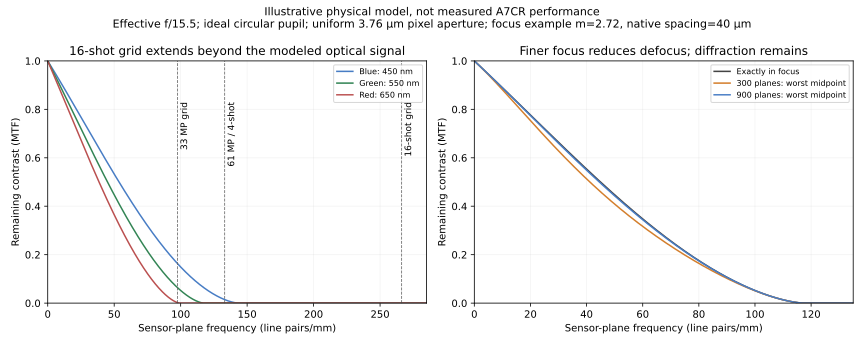

# 900 focus planes, A7CR and pixel shift: expected benefit

Date: 2026-11-07. **ARGUED recommendation:** finer calibrated focus sampling plus
an A7CR with four-shot pixel shift is a credible route to better macro image
fidelity. Expect more consistent focus, cleaner fine color, less aliasing and
more usable low-contrast information. Sixteen-shot mode is a research option;
the present high-magnification optical path is unlikely to deliver 240 MP of
independent spatial detail. No A7CR image-quality gain has been measured here.

Assume 900 distinct focus planes cover the same depth as today's 300-frame
width-1 bracket, the subject stays still, illumination/polarization stay fixed,
and SD storage is adequate. One-unit software commands are not necessarily
distinct planes: the [physical review](../sony-focus-control-2026-11-07-capture-review/results.md)
found repeated plateaus and approximately threefold finer local response on the
A7C II. A full ladder and a different body require calibration; the local ratio
does not establish uniform micrometre spacing across 900 positions.

## DERIVED: distinguish sampling, exposure and output size

Sony specifies a 61 MP sensor with normal 9504×6336 output. Four-shot composites
retain that approximately 60.2 MP grid; sixteen-shot composites are
19008×12672, approximately 240.8 MP. The camera records uncompressed RAWs with
one-pixel and half-pixel sensor displacements, respectively. SD-only recording
is explicitly supported. These are format/capture facts, not effective optical
resolution. [Sony specifications](https://www.sony.com/electronics/support/e-mount-body/ilce-7cr/specifications),
[Sony composite dimensions](https://electronics.sony.com/imaging/interchangeable-lens-cameras/all-interchangeable-lens-cameras/p/ilce7crs),
[Sony pixel-shift workflow](https://support.d-imaging.sony.co.jp/support/ilc/psms/ilce7cr/en/index.html).

| Scenario | Focus planes | RAW exposures | Nominal output grid | Integration relative to current |
| --- | ---: | ---: | ---: | ---: |
| A7C II, width 1 | 300 | 300 | 33 MP | 1× |
| A7C II, fine steps | 900 | 900 | 33 MP | 3× |
| A7CR, fine steps | 900 | 900 | 61 MP | 3× |
| A7CR, fine steps and four-shot groups | 900 | 3600 | 61 MP, directly sampled RGB | 12× |
| A7CR, fine steps and sixteen-shot groups | 900 | 14400 | 241 MP sampling grid | 48× |

Integration assumes equal exposure per RAW and comparable optical throughput.
It is not a comparison at equal capture time. Ideal independent-noise SNR at a
common output size and spatial bandwidth scales as the square root: 1, 1.73,
approximately 1.73, 3.46 and 6.93. The two-body comparison additionally assumes
comparable quantum efficiency and photon-limited operation, not measured sensor
equivalence. These factors apply only where compatible useful observations
increase accordingly. Most of the stack is defocused at any particular fine
feature; all 900 or 14400 images cannot be averaged indiscriminately there.

Four versus sixteen exposures per plane can ideally double SNR again when both
are rendered at the same 61 MP scale. It does not guarantee twice the SNR in
each of the four times as many 241 MP output pixels. Holding total photons/time
constant removes the exposure-count noise dividend; sampling diversity can
still help. A longer single exposure can also gather more photons with fewer
readouts, but cannot provide the missing CFA sampling phases.

At the owner's tested 0.2-second shutter, exposure alone takes 3 minutes for
900 RAWs, 12 minutes for 3600 and 48 minutes for 14400. At one second these are
15 minutes, one hour and four hours. Focus settling, sensor-shift intervals and
card writes add time. Storage adequacy does not remove that cost or the need
to track camera/lens/illumination stability over a long run. No subject motion
is assumed. Source sample counts are about 5.5×, 22× and 88× the current stack
for the three A7CR scenarios; compute/storage traffic will grow substantially,
though algorithm runtime is not predicted by those ratios.

## Optical path: where information survives and where it does not

The camera's reported f/5.6 already includes the Viltrox 2× multiplier on the
f/2.8 lens. Do not multiply by two again, and do not advise opening beyond the
available aperture. Macro working aperture is larger than the reported number:
`N_eff = N_reported × (1 + m/p)`, with pupil magnification p for the complete
optical system. Assuming p=1 was specifically contradicted in the earlier rig
metrology. The [capture reference](../../docs/agents/capture-reference.md),
[M5](../../docs/research/M5-diffraction-measured.md) and
[M84b](../../docs/research/M84b-ruler-metrology.md) support a reference working
range approximately f/13.5–17.2 at high magnification. Its lower/upper bounds
have unequal evidential strength, and it is not a fresh calibration of the two
November slides or the future body.

For an ideal incoherent circular pupil, cutoff is `1/(wavelength × N_eff)` and
Airy first-zero diameter is `2.44 × wavelength × N_eff`. Cutoff is where contrast
reaches zero, not where useful photographic contrast remains high. Real lens
aberrations, defocus, flare, sensor integration and reconstruction further affect
transfer. [Edmund Optics diffraction reference](https://www.edmundoptics.co.uk/knowledge-center/application-notes/imaging/limitations-on-resolution-and-contrast-the-airy-disk/).

| Sensor-plane quantity | Value or range |
| --- | ---: |
| A7C II physical pitch / full-grid Nyquist | 5.12 µm / 97.7 lp/mm |
| A7CR physical pitch / full-grid Nyquist | approximately 3.76 µm / 133.1 lp/mm |
| A7CR sixteen-shot output pitch / grid Nyquist | approximately 1.88 µm / 266.2 lp/mm |
| Ideal blue cutoff, 450 nm, reference aperture range | 130–165 lp/mm |
| Ideal green cutoff, 550 nm | 106–135 lp/mm |
| Ideal red cutoff, 650 nm | 90–114 lp/mm |

These wavelengths represent bands, not narrowband camera response measurements.
The lamp, specimen reflectance, filter transmission and each CFA channel weight
a broad spectrum. Red/blue Bayer sample-grid Nyquist along the axes is only
half the full-grid value: approximately 48.8 lp/mm on A7C II and 66.6 lp/mm on
A7CR. Green is a quincunx lattice with direction-dependent support. Demosaicing
can exploit cross-channel correlation, so these are sampling facts rather than
an assertion that ordinary photographs abruptly lose all color above them.

The reference optics therefore retain important color information that a single
Bayer exposure does not sample independently. Four-shot full-color capture
addresses this. In contrast, most of the sixteen-shot grid above 133 lp/mm has
little or no optical signal in this high-magnification configuration. A small
blue-frequency tail may remain. Near cutoff, contrast is very low and high
photon counts become especially important.

Pixel shift moves the same physical photosites. It does not shrink their
light-collecting aperture. The model retains the same physical-pixel sinc
transfer for four- and sixteen-shot A7CR data; merely requesting a finer output
grid cannot improve that transfer. Deconvolution can restore attenuated signal
where measurement SNR and transfer permit it, but cannot recover arbitrary
scene detail at an optical-transfer zero. Priors can invent a plausible answer
there; that would not be measured super-resolution.

The 2× converter enlarges the image before sampling, which can recover detail
otherwise undersampled. It also enlarges diffraction/aberration blur, costs
two nominal stops and may add its own aberrations or flare. It does not double
the entrance pupil's object-space resolving power. The current tests contain
no bare-lens or converter comparison, so no numerical Viltrox penalty is known.

The illumination polarizer and X4 CPL can suppress specular glare that masks
diffuse texture or clips channels. This raises useful contrast, not numerical
aperture or optical bandwidth. They also reduce throughput and alter which
surface reflection components are recorded; extra integration can compensate
photon loss. Their wavelength dependence, filter flatness and flare could
matter, but a brand/coating specification does not measure the complete path.
Keep polarization fixed within a reconstruction group. Differently polarized
passes represent different appearances and belong in separate layers unless
an explicit reflectance model is used.

The KL1500 LCD uses a halogen source; diffusion makes illumination gentler and
the source is broadband rather than a narrow laser. The warm spectral balance
can leave blue-channel photon SNR weaker, even though blue has a higher
diffraction cutoff. WB multiplication cannot manufacture those photons.
Per-channel exposure/noise treatment is needed. The owner's 3000/3300 K WB
settings are processing metadata, not measurements of the lamp's spectrum.
[Manufacturer datasheet, archived copy](https://files.pulchlorenz.de/Beleuchtung/Schott%20KL1500lcd.pdf).

## What each upgrade should buy

**900 versus 300 planes — ARGUED:** more locations get a frame nearer their best
focus, and more near-focus samples are available for noise-aware fusion. The
largest gains should occur between old planes, on thin sloping features and
where different color channels peak at slightly different focus. Features
already exactly focused do not get a sharper optical PSF merely by adding
neighboring frames. Real occlusion halos are not guaranteed to disappear.

**DERIVED illustration, not a forecast:** use effective f/15.5, magnification
2.72 and 40 µm native spacing, roughly the middle of the older ruler's measured
32–49 µm spacing. Reducing spacing threefold reduces worst-midpoint focus error
from 20 to 6.7 µm. A quadratic-pupil defocus model predicts about 9% more contrast
at 60 lp/mm and 6% at 80 lp/mm at that midpoint. Across the stated aperture and
spacing examples the increases span about 3–24% at 60 lp/mm. The in-focus
placebo gains zero. This makes moderate improvement plausible while explaining
why threefold focus sampling is not threefold lateral resolution. The lens's
real aberrations and current normalized-command spacing have not been calibrated
into this model.

**A7CR single-shot — ARGUED:** the delivered grid has about 1.84× as many pixels
and 1.36× the linear sampling of A7C II. That is useful headroom, not a guarantee
of 36% more resolved detail. In the ideal f/15.5 green-light model, physical
pixel integration alone changes MTF50 from 43.1 to 45.0 lp/mm, only about 4%.
At 80 lp/mm its surviving contrast is about 15% higher. CFA/color reconstruction
is omitted from that simple comparison and can have a larger effect. The
upgrade should offer better color sampling and reconstruction support even
when diffraction keeps luminance gains modest. Smaller photosites collect
approximately 54% as many photons per pixel at equal sensor irradiance; compare
noise at equal displayed size, not mismatched 100% crops. Actual read noise,
full well, spectral response and dynamic range require an A7CR profile.

**Four-shot pixel shift — ARGUED strongest addition for this path:** integer
sensor offsets place red, green and blue measurements at each output location,
instead of requiring missing colors to be inferred from surrounding pixels.
Expected benefits are more faithful fine colors, fewer false-color/zipper/moire
artifacts, more stable weak texture and lower noise from more integration.
Full-color data also makes channel-dependent optical correction less dependent
on demosaic guesses. It does not remove genuine longitudinal chromatic blur;
that needs focus-dependent, channel-specific modeling. The physical sampling
opportunity is real; an improved final Strehl photograph is not yet measured.

**Sixteen-shot — ARGUED diminishing spatial returns at current magnification:**
half-pixel phases provide genuine additional measurements and twofold linear
grid capacity. Most red/green optical support is already within the four-shot
grid. The likely extra value is more stable estimation, less residual aliasing,
and lower noise when downsampled or reconstructed at a suitable output size.
Additional blue/lower-magnification detail is possible. A physically meaningful
61 MP master could be the best output of a sixteen-shot capture; 241 MP is
not mandatory. Compare sixteen-shot data with four repeated four-shot groups
at matched exposure to separate phase diversity from simply taking more light.

Sixteen-shot becomes more interesting when the optical image is sharper at the
sensor, for example at lower magnification or with a faster effective optical
path. A bare-lens sixteen-shot capture cropped 2× has approximately the same
output sample count as converter-plus-four-shot at the corresponding field of
view, but its physical photosites still average over twice the object width.
Removing converter aberrations might help while reduced optical magnification
might hurt; this is an untested alternative, not a promised better configuration.
Materially more object detail ultimately requires higher useful numerical
aperture and/or lower aberration, not only a finer sensor-shift grid.



## What Strehl can do now, and the justified new work

Current ordinary stacking already uses noise-aware multiscale fusion and a
global fit of focus-breathing geometry. The November 2 ensemble gate improves
averaging where the whole stack supplies little structure; it does not make
every highly textured region an optimal repeated-observation average.
[Current quality results](../image-quality-2026-11-02/results.md).
Experimental multi-stack builds also expose interleaved focus, repeated
observations and original-CFA reconstruction with native fallback. Those
features are not proof of pixel-shift support; the complete chart experiment
showed sparse replacement without a clearly visible detail gain.
[Current multi-stack contract](../../docs/multi-stack.md).

The [November 1 breathing-SR trial](../super-resolution-2026-11-01/results.md)
was rejected for integration: diversity was mostly radial, absent at the
center, and entangled with defocus. Better held-out CFA prediction even failed
as an independent detail discriminator. Deliberate two-dimensional shifts at
fixed focus change that premise. Direct RGB reconstruction from several CFA
observations is established prior art, not a newly invented principle.
[Wronski et al., 2019](https://research.google/pubs/handheld-multi-frame-super-resolution/).

**Proposed integration, not implemented here:**

1. Represent a focal plane and its 4/16 shift members explicitly. Record exposure,
   CFA origin, shift order, focus approach and completion. Complete a group before
   moving focus; validate every member. Nominal offsets initialize a residual
   geometry fit rather than replace it. Capture still writes only to SD.
2. Add an A7CR calibration profile: active bounds/levels, noise, defects/fixed
   pattern, channel gains and optical corrections for this complete path.
   Current A7C II coefficients are guarded by body identity and must not be
   copied blindly. Fit scene-dependent breathing at runtime.
3. First build a conservative native-grid, full-color reconstruction per focus
   group from original CFA samples, retaining noise/support information. Use it
   as a controllable baseline; keep Sony's composite as another comparator,
   not ground truth. Do not load a full-color ARQ as if it were Bayer RAW.
4. Then test joint focus-and-shift reconstruction. Fit a latent color image from
   the original sensor observations with measured geometry, pixel integration,
   wavelength-dependent PSF/defocus, exposure and one noise model. A useful
   local information guide is `sum_i |H_i(f)|^2 / variance_i`: a defocused image
   contributes little at a frequency it has suppressed, while multiple equally
   focused shift members can contribute strongly. Multiple focus samples may
   improve PSF/aberration estimation and regularized deconvolution; they cannot
   remove an absent optical passband.
5. Handle depth boundaries with visibility/layer-aware support. Foreground
   defocus spreads across background even with a perfectly stationary subject.
   A single global deconvolution kernel or indiscriminate averaging can amplify
   those errors. Retain the ordinary result where data cannot support a change.

Keep original storage u16 CFA and transient arithmetic f32. Gather in tiled
consumers, retain a bounded set of useful focus groups and avoid an aligned
volume of thousands of RGB images. More frames can improve model estimation,
but incorrect registration, correlated fixed-pattern noise and PSF bias can
also reinforce artifacts. Numerical support must be tested with known-scene,
phase-destroyed and equal-photon controls and reviewed on complete photographs.
The current task does not commission that implementation or a new RAW campaign.

## Hardware boundary and evidence

Sony documents both four- and sixteen-shot operation in its own Remote software.
The owner's [Command 2.02 audit](../sony-focus-control-2026-11-07/sdk-audit.md)
documents four-shot count writes but a restriction on writing sixteen directly.
An actual A7CR must verify the public-control route and interleaving complete
pixel-shift groups with external focus moves. A7C II focus success does not
establish either. No Wi-Fi/ESP32/power guarantee is inferred from this analysis.

All new numerical results are **DERIVED**. Command actually executed from the
repository root, final exit 0:

```powershell
$env:OMP_NUM_THREADS='1'
$env:OPENBLAS_NUM_THREADS='1'
python -X utf8 experiments/sony-upgrade-2026-11-07/model.py
```

One worker, Python 3.12.10, NumPy version and source SHA-256 in
[`model.json`](evidence/model.json). The script
checks DC/cutoff, zero-defocus quadrature against analytic MTF (maximum absolute
error 1.79e-7), an in-focus zero-gain placebo and unchanged physical transfer
when only the output grid changes. The saved figure was visually inspected.
These checks commission arithmetic, not the chosen optical parameters. No
photographic sharpness metric, engine render or new capture was run; flat-ROI
and photographic comparison rules consequently do not apply to a measured
quality claim, because none is made. This is author analysis without independent
research review or production/SYNTHESIS promotion.

For repository publication, `model.py` also saves a vector version of the same
figure. It was rerun successfully after that output-only change; the numerical
model is unchanged. The capture review's `publish-evidence.py` copies the compact
model receipt and SVG into this directory. No private capture images, caches or
SDK distributions are included.
